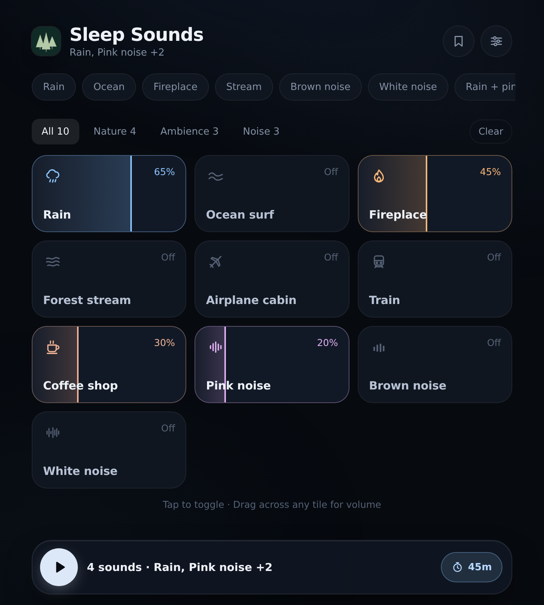

<h1 align="center">Sleep Sounds</h1>

<p align="center"><em>Night air, softly mixed.</em></p>

<p align="center">An offline sound mixer for sleep and focus on the web, Android, and iOS.</p>

<p align="center">
  <a href="https://rogersau.github.io/sleep-sounds/">Open web app</a> ·
  <a href="https://github.com/rogersau/sleep-sounds/releases/tag/v1.0.0">Download v1.0.0 APK</a> ·
  <a href="#run-locally">Run locally</a> ·
  <a href="AUDIO-CREDITS.md">Audio credits</a>
</p>

<p align="center">
  
</p>

## Mix a soundscape

- **Tactile full-tile mixer.** Built with an OLED-friendly Midnight Obsidian UI, custom icons for every sound, and subtle per-sound accent fills. Start from the horizontal presets strip or filter by **Nature**, **Ambience**, or **Noise**, then tap any tile to toggle it and drag horizontally across the tile to set its volume.
- **Floating bottom dock & sleep timer.** Play/pause, see your active soundscape at a glance, and open the sleep timer sheet (15–120 minutes with an optional fade-out) from one persistent dock. Pausing playback pauses the countdown.
- **Save your favourites.** Open the **Saved mixes** sheet from the header to name, star, recall, rename, and delete mixes on your device. Saved mixes include your volume boost.
- **Listen offline.** The app runs locally without an account or backend. The mobile app bundles all ten sounds, and the web app can cache the full library for offline use.

## Run locally

The web and mobile apps share a single Expo / React Native codebase (`App.tsx` and `mobile/`). The live web app is hosted on GitHub Pages at <https://rogersau.github.io/sleep-sounds/>.

Download the signed Android APK directly from the [v1.0.0 release](https://github.com/rogersau/sleep-sounds/releases/tag/v1.0.0), or grab the latest CI build from the [Android APK workflow](https://github.com/rogersau/sleep-sounds/actions/workflows/android-apk.yml) (retained for 30 days).

Install dependencies with Node.js 22.13+ or 24.3+:

```sh
npm ci
npm run web      # Run Expo web locally
npm run android  # Run on Android emulator or connected device
```

For Android, have the Android SDK and an emulator or connected phone ready. On a Mac with Xcode, use `npm run ios`. To export a static web build for GitHub Pages, run `npm run build:web`.

The native app bundles all ten sounds for offline listening, remembers your mix, and resets the boost at launch. To test offline and lock-screen listening, use an installed release build with the JavaScript bundle embedded.

## Development checks

```sh
# Web and shared audio
for test in tests/*.cjs; do node "$test" || exit; done
python3 tests/audio.py

# Native
npm run typecheck
npm run test:native
```

Run `npm run bundle:native` to export both native bundles to `.expo/native-export`. See the [test guide](tests/README.md) for audio test prerequisites and manual playback checks.

## Audio credits

See the [recording sources, licences, and regeneration instructions](AUDIO-CREDITS.md). Audio licensing is separate from the app source.
